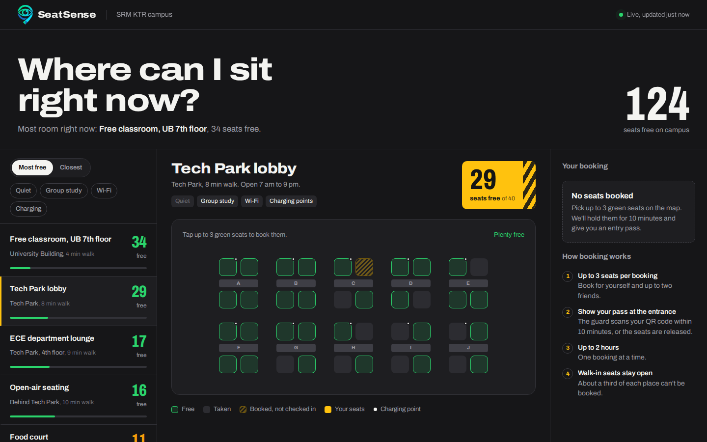
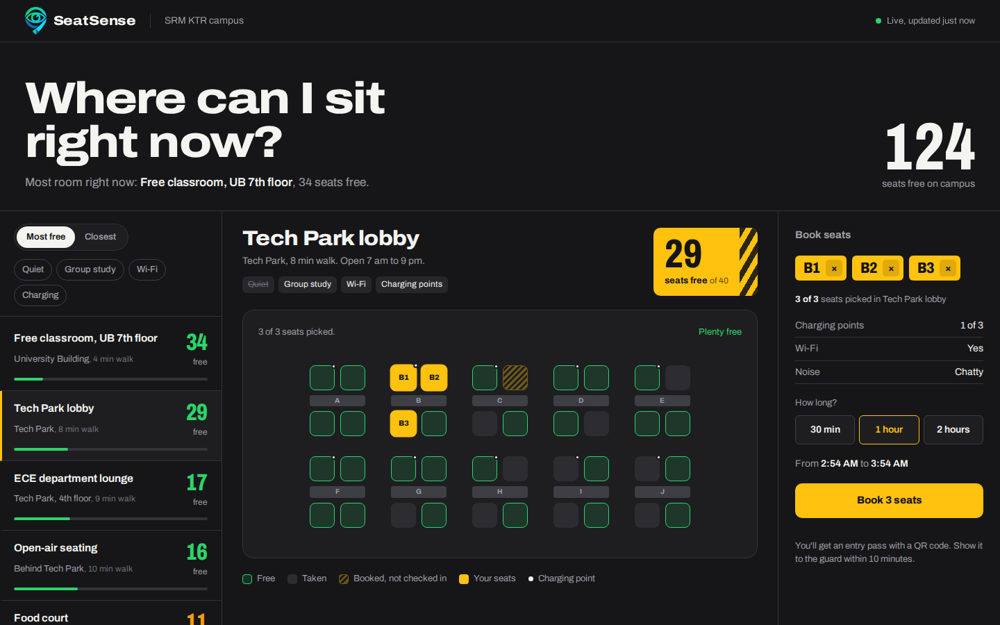
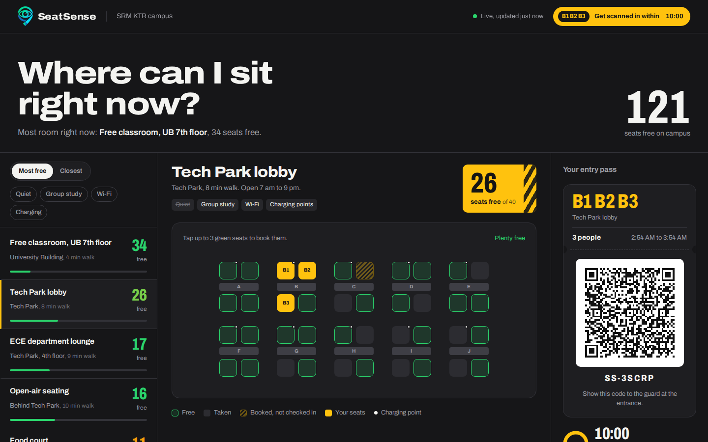
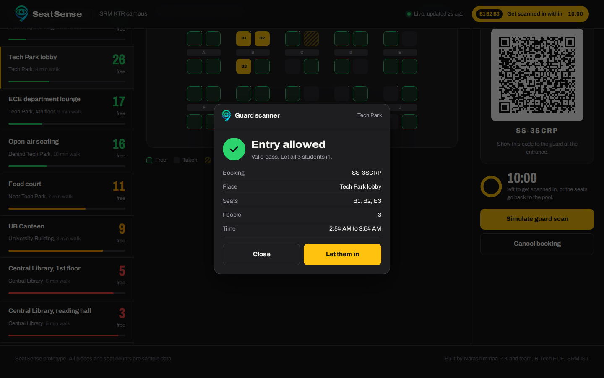

<p align="center">
  
</p>

<h1 align="center">SeatSense</h1>
<p align="center"><b>An App-Based Solution for Live Seat Tracking and Booking on Campus</b></p>
<p align="center">Library full again? Check before you walk over.</p>

---

## The problem

During free periods, SRM KTR students walk from one full place to the next, usually the Central Library and the UB Canteen, and lose study time. Meanwhile other usable spaces (Tech Park lobbies, department lounges, empty classrooms) stay half empty. The library also has no Wi-Fi, and bags are used to "reserve" seats for hours.

There are seats on campus. Students just can't see them.

## The idea

SeatSense is an app that shows how many seats are free in every study space on campus, live, and lets a student book up to 3 seats before walking over. A QR entry pass is generated for the booking, and the guard scans it at the entrance.

**Goal:** any student finds a free seat in under 30 seconds.

## Screenshots

| Browse places | Pick up to 3 seats |
|---|---|
|  |  |

| QR entry pass | Guard scan |
|---|---|
|  |  |

## Features (in this prototype)

- Live free-seat counts for 8 sample campus spaces, sorted by most free or closest
- Filters for quiet, group study, Wi-Fi and charging points
- Seat-level floor plans (free, taken, booked-not-checked-in, your seats, charging points)
- Book **up to 3 seats per person**, for 30 min, 1 hour or 2 hours
- A **QR entry pass** (real, scannable QR code) with a 10-minute check-in window
- A simulated **guard scanner** screen: "Entry allowed" with booking code, seats and number of people
- Seats are released automatically if the pass isn't scanned in 10 minutes
- Works on laptop and phone, and runs fully offline

## How it works

1. The student opens the app and logs in with their SRM NetID (planned).
2. They pick a place and tap up to 3 free seats, then choose how long they need.
3. The app creates an entry pass with a QR code. Seats are held for 10 minutes.
4. The guard scans the pass at the entrance and lets the group in. Seats become "in use".
5. When the student scans out (or the time ends) the seats become free again.

Walk-ins without a booking are scanned by the guard using their student ID and given a free seat, so everyone who enters is counted.

Free seats are calculated as:

```
free seats = total seats - seats checked in by the guard - seats on hold
```

In the full system, AI added to the **existing campus CCTV** would spot which seats are actually free, so the count stays right even if someone forgets to scan out. This part is planned and is **not** built in the prototype.

## Run it

No install or internet needed.

1. Download this repository (or just `index.html`).
2. Double-click `index.html`. It opens in Chrome, Edge or Firefox.

Refreshing the page resets the demo.

**Live demo:** if GitHub Pages is on, it is available at `https://<your-username>.github.io/<repo-name>/`.

> All places and seat numbers in the prototype are **sample data**. There is no backend yet.

## Project structure

```
seatsense-prototype/
├── index.html            # the whole prototype (HTML, CSS, JS, font and QR library inlined)
├── assets/
│   ├── logo.png          # SeatSense logo (transparent)
│   └── screenshots/      # screenshots used in this README
├── docs/
│   ├── SeatSense_Pitch_Deck.pptx
│   └── SeatSense_DTM_Report.docx
├── CONTRIBUTING.md       # branch and commit conventions
├── setup-branches.sh     # creates the standard branches
├── LICENSE
└── README.md
```

## Built with

- Plain HTML, CSS and JavaScript (no framework, single file)
- [qrcode-generator](https://github.com/kazuhikoarase/qrcode-generator) for the QR pass (inlined)
- Archivo variable font (embedded)

## Roadmap

- [ ] Backend and database for real bookings
- [ ] SRM NetID single sign-on
- [ ] Student mobile app and guard scanner app (camera-based QR scan)
- [ ] AI seat detection on existing CCTV
- [ ] Admin dashboard with usage data for library and administration
- [ ] One-semester pilot in Central Library, UB Canteen and Tech Park lobby

## Team

Design Thinking and Methodology (21DCS201P), Department of ECE, SRM Institute of Science and Technology, Kattankulathur.

- Narashimmaa R K
- S Sujan
- Hariharan J
- Alban Josh
- E Sujeeth

Guided by **Dr. Praveen Kumar S**, Assistant Professor, Department of ECE.

## License

Released under the [MIT License](LICENSE).
